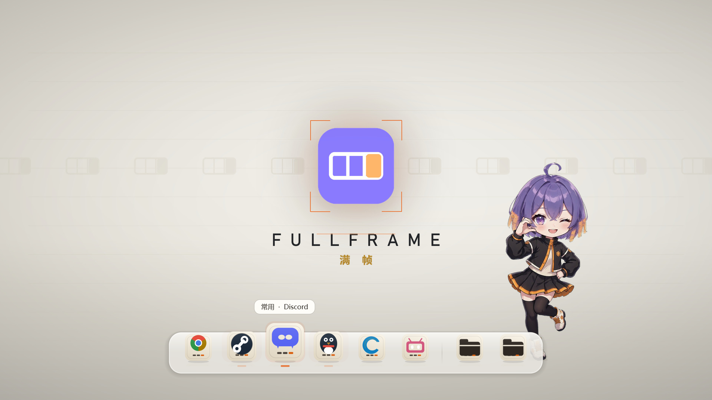
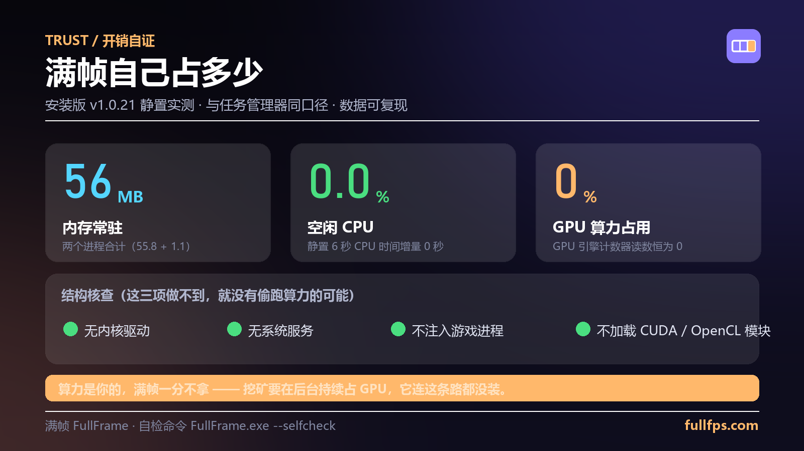

<div align="center">

# FullFrame · 满帧

**全游戏帧率优化工具 · Windows 游戏玩家的桌面管家**

*Game FPS optimization & desktop toolkit for Windows. No source poking, no drivers, no GPU abuse.*

[](https://github.com/qixaa/FullFrame/releases)
[](#%E4%B8%8B%E8%BD%BD-download)
[](#%E5%AE%83%E8%87%AA%E5%B7%B1%E5%8D%A0%E5%A4%9A%E5%B0%91-overhead--transparency)
[](#%E8%AE%B8%E5%8F%AF-license)

**[⬇ 下载最新版 (Download)](https://github.com/qixaa/FullFrame/releases/latest)** · [官网 fullfps.com](https://fullfps.com/#download)

</div>

---

FullFrame 是一款面向 Windows 游戏玩家的桌面优化工具：一键优化 + 硬件体检 + 帧率实测，同时把一套 macOS 风格的桌面体验（菜单栏、Dock、主题工坊、小组件）带进 Windows。**不改游戏文件、不装内核驱动、不碰游戏进程。**

> ⚠️ 市面上有打着「优化」幌子偷算力挖矿的软件。FullFrame 把自己的开销全部摊开实测，并给出三步自查方法，欢迎任何人验证——见下方[透明度章节](#它自己占多少-overhead--transparency)。

## ✨ 主要功能

### 🎮 游戏优化与体检
- **56 项一键优化**：后台进程、电源计划、显存占用等系统侧整理，全程可视、可中途取消
- **11 项硬件体检**：机器画像 + PDF 报告，优化前后对比自动存档
- **帧率实测 / 跑分**：基于 PresentMon 的真实帧采集，不写死一个数字

### 🖥 macOS 风格桌面体验

| | |
|---|---|
|  |  |
| *悬浮 Dock：波纹放大、未读角标、后台缩略图、游戏全屏自动让位* | *桌面小组件：CPU/GPU/内存/显存实时仪表 + 一键满帧* |
|  |  |
| *主题工坊：4 套主题 × 立绘 × 壁纸/图标/指针混搭，一键应用与还原* | *散热控制中心：CPU/机箱/显卡风扇统一调速* |

### 🧰 工具箱
- **散热控制中心**：风扇统一调速，NVIDIA 显卡经 NVAPI 真实写入
- **C 盘空间管家**：软件/游戏搬家、清理建议、列表排序
- **超频工作台**：P/E 核倍频、电压、内存时序接口与实时监测

### 🗣 小满语音助手
- 全离线语音模型（约 5MB 内置），断网可用
- 16 条语音指令直接指挥软件执行功能，支持连续对话与打断
- 首字响应从 3.7 秒优化到 1 秒出头

## 🔍 它自己占多少（Overhead & Transparency）

安装版静置状态实测，全部数据可用系统自带工具复核：

| 项目 | 实测 |
|---|---|
| 内存常驻 | 56 MB（两进程合计，任务管理器同口径） |
| 空闲 CPU | 0.0% |
| GPU 算力占用 | **0%**（GPU 引擎计数器无读数） |
| GPU 计算库 | 无（CUDA / OpenCL / NVML 均未加载） |
| 内核驱动 / 系统服务 | 无 / 无 |
| 进程注入 | 无（不写游戏内存、不装全局钩子） |
| 外联域名 | 仅 fullfps.com 与 gitee.com（查更新） |



**三步自查：**
1. 任务管理器 → 详细信息 → 勾选「GPU 引擎」列 → 看 FullFrame 那行是否为 0
2. 资源监视器 → 网络 → 看它连接的域名
3. `services.msc` 与设备管理器搜索 FullFrame → 应无结果

## ⬇ 下载 (Download)

- **GitHub Release（备用，单文件整包）**：[releases/latest](https://github.com/qixaa/FullFrame/releases/latest)
- **官网直链（主线路）**：https://fullfps.com/#download
- 交流群：**1125964330**

系统要求：Windows 10 / 11（64 位）。安装版 183.3 MB / 便携版 181.6 MB。

SHA-256 校验：

```
安装版  f2cc7b293127830e0208efeb798371971290c148c4e6d6f1ec591966c50c755a
便携版  1d80de4168da5cd23db23b2d8aed0baef849cf4982dd1cb2769545221350d3e8
```

## ❓ FAQ

**会被杀毒软件报毒吗？**
软件未签名，部分杀软可能误报。安装时会自动申请加入 Windows Defender 白名单；360/火绒等请手动放行。

**安全吗？会动我的游戏吗？**
只调系统侧配置，不修改任何游戏文件，不注入游戏进程，检测项与优化项分离。

**优化效果因人而异吗？**
是。帧率提升取决于机器瓶颈所在，所以软件同时提供体检和跑分，让你先看清瓶颈再优化。

## 📄 License

Freeware（免费软件）。仅供个人使用，禁止二次分发捆绑。

---

<div align="center">

**满帧 FullFrame —— 只做一件事：让每一帧都是满帧。**

</div>
